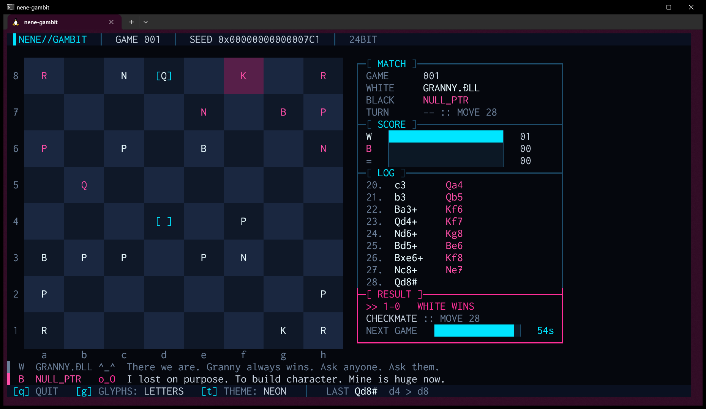
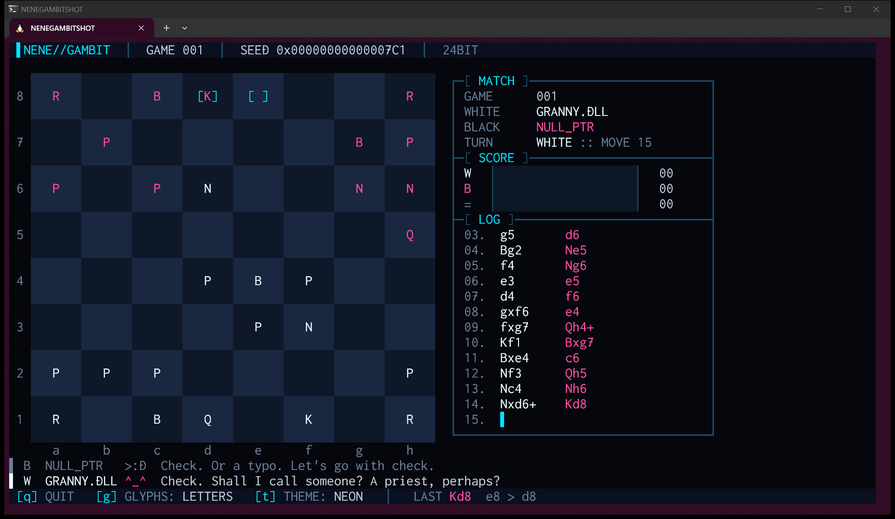
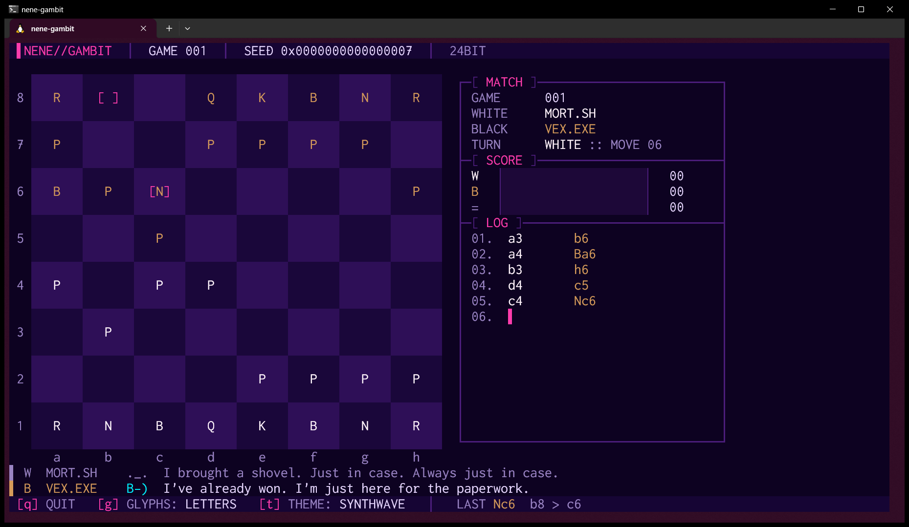
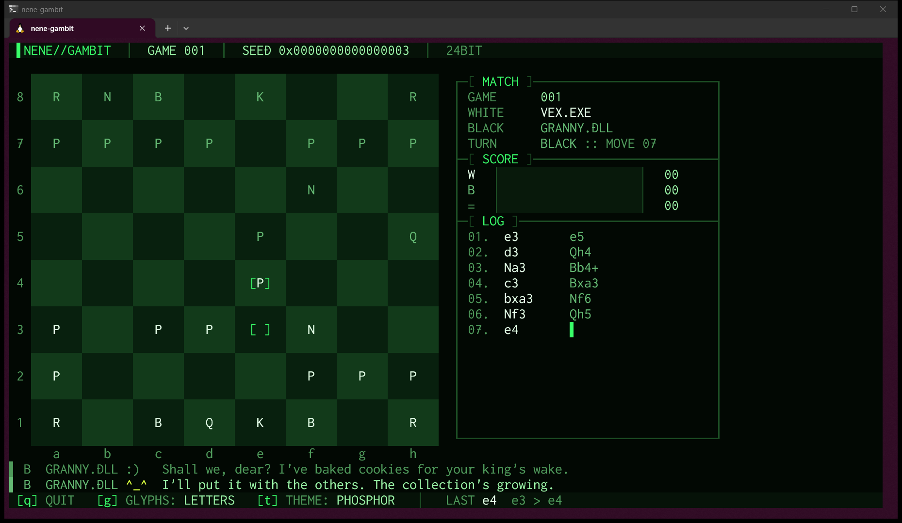
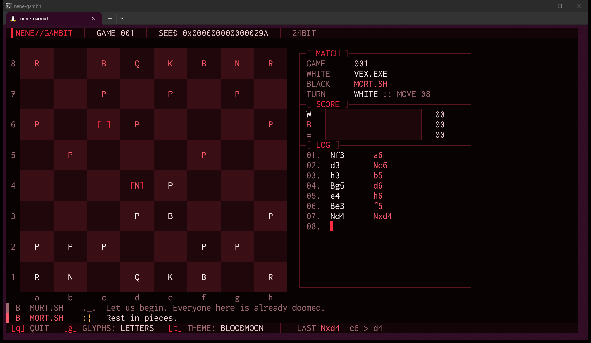
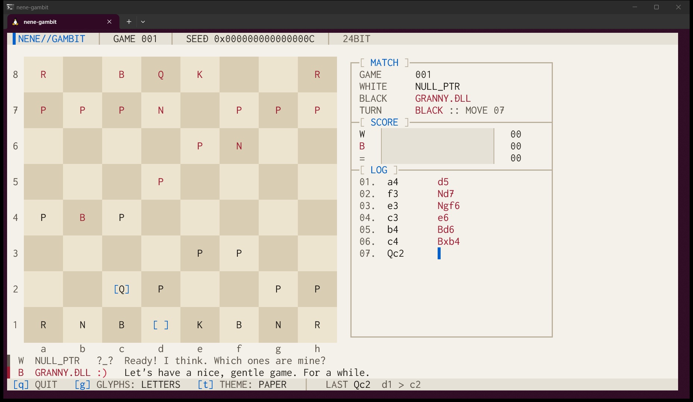

# NeNe Gambit

> *Four snarky AIs play chess in your terminal. Forever. Press `q` to make them stop.*

A terminal screensaver in which a cast of four plays chess with a hand-written chess AI, game after game, trading insults the whole time.
When one game ends, the next one starts. You don't have to do anything. Just watch, and smirk now and then.

[](https://github.com/hideyukiMORI/nene-gambit/releases/latest)


**English** · [日本語](README.ja.md)



<sub>A real screenshot: the v0.1.0 binary running in Windows Terminal on WSL2 (`--seed 1985`, 120×30).
Granny has just delivered mate on move 28. NULL_PTR insists it lost on purpose.</sub>

---

## Install

```bash
curl -fsSL https://raw.githubusercontent.com/hideyukiMORI/nene-gambit/main/install.sh | bash
```

This downloads the latest [release](https://github.com/hideyukiMORI/nene-gambit/releases/latest), verifies it against `SHA256SUMS`,
and only then installs it as `~/.local/bin/nene-gambit`. If the checksum doesn't match, nothing is installed.
The whole script is [install.sh](install.sh), about 45 lines. Reading it before you pipe it takes under a minute.

- Requirements: Linux on x86_64 with glibc 2.35 or newer (Ubuntu 22.04+). Tested on Ubuntu under WSL2 with Windows Terminal
- No Swift needed. It is a single file with the Swift standard library linked statically; the only dynamic dependencies are libc, libm, libstdc++ and libgcc_s
- To uninstall: `rm ~/.local/bin/nene-gambit`

<details>
<summary>Install by hand</summary>

```bash
v=0.1.0
curl -fsSL -O https://github.com/hideyukiMORI/nene-gambit/releases/download/v$v/nene-gambit-$v-linux-x86_64.tar.gz \
           -O https://github.com/hideyukiMORI/nene-gambit/releases/download/v$v/SHA256SUMS
sha256sum --check SHA256SUMS
tar -xzf nene-gambit-$v-linux-x86_64.tar.gz
./nene-gambit-$v-linux-x86_64/nene-gambit
```
</details>

## How to play (well, how to watch)

```bash
nene-gambit
```

| Key | |
| --- | --- |
| `q` | Quit (Ctrl+C works too; however it ends, your terminal is restored) |
| `g` | Switch piece glyphs: letters `K Q R B N P` ⇔ chess symbols `♚♛♜♝♞♙` |
| `t` | Next color theme (12 in total) |

| Option | |
| --- | --- |
| `--theme NAME` | `NEON` `PHOSPHOR` `AMBER` `SYNTHWAVE` `GLACIER` `BLOODMOON` `VAPOR` `MONO` `TOXIC` `GILDED` `ABYSS` `PAPER` |
| `--glyphs symbols` | Start with chess symbols |
| `--seed N` | Same seed, same games, **same banter** |
| `--move-interval SEC` | Time per move (default 1.0 s) |
| `--result-pause SEC` | How long the result stays up after a game (default 3 s) |
| `--version` | Print the version and exit |

The terminal needs at least 67×15 (75×15 with chess symbols). At **100×30 or larger you get the big board** (three rows per square).
If the window is too small, it tells you, in one line, how big it needs to be.

### Reading the screen



- **Board**: the two squares of the last move are bracketed `[ ]`. A mated king's square sinks into a dark color
- **MATCH**: game number, who plays White and Black, whose turn it is and the move number
- **SCORE**: running totals of White wins, Black wins and draws, as bars
- **LOG**: the most recent moves in SAN. The cursor `▌` blinks in the column of the side to move
- **RESULT**: appears when a game ends: the outcome, the reason (checkmate, stalemate, threefold repetition, fifty-move rule, insufficient material) and a countdown to the next game
- **COMMS**: the two lines under the board, the latest things the cast said. The brighter line is the newer one

## The cast

At the start of every game, two of the four are drawn at random to sit at White and Black. Each plays differently, and each is rude differently.

| | How they play | In their words |
| --- | --- | --- |
| **VEX.EXE** `>:)` | Overconfident attacker. Loves to bring pieces near the enemy king. Looks 3 plies ahead | *"Initializing arrogance... 100%."* |
| **MORT.SH** `x_x` | Gentle undertaker. Cares about king safety and pawn structure. Looks 3 plies ahead | *"Another game. Sixty-four tiny graves."* |
| **NULL_PTR** `o_O` | Zero-plan chaos. Looks 1 ply ahead and strays far from the best-looking move. Does take free pieces | *"I have no plan. Soon, neither will you."* |
| **GRANNY.DLL** `^_^` | Sweet, merciless, holds grudges. Searches deepest, 4 plies ahead | *"Shall we, dear? I've baked cookies for your king's wake."* |

Each has 50 lines, written for specific events: capturing, being captured, check, promotion, castling, en passant, quiet positions, winning, losing, drawing, and more.
A few of them:

> **VEX.EXE** (losing the queen) *"That queen was a decoy. I'll explain later. Never."*<br>
> **MORT.SH** (losing a piece) *"He knew the risks. He was a pawn."*<br>
> **NULL_PTR** (after losing) *"Segmentation fault (core dumped). Emotionally."*<br>
> **GRANNY.DLL** (after losing) *"Well done, dear. I'll be telling everyone you cheated."*

The other 196 are yours to collect.

## Twelve themes

Cycle with `t`: `NEON` (default), `PHOSPHOR` (green CRT), `AMBER` (amber CRT), `SYNTHWAVE`, `GLACIER`, `BLOODMOON`, `VAPOR`, `MONO`, `TOXIC`, `GILDED`, `ABYSS`, and `PAPER` (the only light theme).

| SYNTHWAVE | PHOSPHOR |
| --- | --- |
|  |  |
| **BLOODMOON** | **PAPER** |
|  |  |

In every theme, all text has a contrast ratio of at least 4.5:1 against its background, and White and Black pieces differ in lightness, not just hue (at least 2.2:1).
No human eyeballs this: a test computes it every time from the colors of the cells it actually renders (more below).

---

## Under the hood (a story in eight parts)

NeNe Gambit wears the face of a chess screensaver, but it is also **an experiment in having machines enforce the rules**.
Everything from Issue #1 to the v0.1.0 release happened in a single day, 2026-10-25. Here is some of what actually happened. Every number below is in the repository's records (ADRs, tests, gate proofs).

### 1. All the chess is written from scratch

No chess engine, no chess library. The product has zero external dependencies.
Move generation is checked with **perft** (the number of move sequences possible from a position down to depth N) against the published values from the Chess Programming Wiki.

- Six positions (the starting position, the famous "Kiwipete" and others), all **to depth 5, 480,105,445 positions in total**, without a single miscount
- This runs on every `make check`: about 34 seconds in the release configuration (about 45 on CI). Debug is too slow; the reasoning is in [ADR 0004](docs/adr/0004-perft-runs-in-release-configuration.md)
- The board is a Swift 6.4 `InlineArray<64, Piece?>`. It is a value type, so making a move **produces a new position and leaves the old one untouched**. There is no "unmake move" code at all ([ADR 0003](docs/adr/0003-board-and-move-representation.md))

### 2. The first AI played randomly, and nearly every game was a draw

The first version of the cast picked uniformly among the legal moves. The project owner let it run for about an hour and said:

> Almost every game is a draw. Once it's down to the kings and a few pieces, they just keep running away and it never ends.

A random mover can win material but has no idea how to mate, so it chases the king around until the fifty-move rule.
So an evaluation function and alpha-beta search went in, plus **mop-up** for the winning side (drive the enemy king to the edge, bring your own king closer). In the 16 games measured afterwards, **15 ended in checkmate**.
That K+Q vs K and K+R vs K are mated before the fifty-move rule is checked by tests on every run ([ADR 0009](docs/adr/0009-evaluation-search-and-personas.md)).

### 3. An AI that never reads the clock

The search stops after a fixed depth and node budget, not after a number of seconds.
The board, AI and rendering code **cannot read** the current time, random numbers or environment variables. If they try, a home-grown conformance check fails the build. Randomness comes from a seeded SplitMix64 of our own,
and both the casting and the choice of lines draw from it. That is why `--seed 42` gives you the same games and the same trash talk every single time.

### 4. Rules aren't written down, they're enforced

The repository has 69 rules, each with an ID and a status saying whether a machine enforces it.
Right now **47 are active** (break one and `make check` fails). The rest are honestly labeled "not yet checked by a machine (planned)" or "cannot be blocked by a machine" ([quality gates](docs/QUALITY_GATES.md)).

For example, writing `default:` in a Swift `switch` fails the build. When a new case is added and a branch is forgotten, the compiler should be the one to notice.
The first thing done was measuring Swift 6.4.1 in 56 cases ([phase0-results.json](docs/quality/phase0-results.json)). That showed that besides `default:` and `case _:`,
**`case let other:` also slips past the exhaustiveness check**, that the attribute `@diagnose(..., as: ignored)` **silences warnings even with warnings-as-errors on**,
and that settings in `Package.swift` **override `-warnings-as-errors` on the command line**. The conformance check closes every one of these ([ADR 0001](docs/adr/0001-strictness-is-mechanically-enforced.md)).

And no check is trusted until it has been seen to fail. Violations were planted one at a time, and **53 cases** are recorded in which the intended rule caught them ([gate proofs](docs/quality/gate-proofs.md)).

### 5. Falling into our own CI's trap

To avoid running the heavy gate on draft PRs, the CI job was set to "skipped" for drafts. One day a PR was marked ready right after a push.
CI ran on the old commit, the new commit only got a skip, and **GitHub counted the skip as a success and let a PR that never passed the gate become mergeable**.
It went straight back to draft, drafts were changed to fail instead of skip, and writing `if:` in the workflow at all is now forbidden by the conformance check. The story is recorded in the gate proofs under "checks born from incidents".

### 6. The terminal always comes back

A screensaver that crashes and leaves your terminal wrecked is the one unforgivable sin. So:

- Whether it ends with `q`, Ctrl+C or SIGTERM, **or even crashes with SIGSEGV**, it restores the terminal before it dies (the signal handler only uses writes that don't allocate)
- This isn't checked by eye. The real binary is **actually run inside a pseudo-terminal** (`make smoke`), covering five ways of exiting and making sure that shrinking and restoring the window doesn't crash it

### 7. Three round trips to center a chess symbol

Chess symbols like `♚` are troublesome characters that take one column in some terminals and two in others.

1. First, the program asked the terminal at startup, "after writing this character, how far did the cursor move?", to measure the width
2. Measuring the owner's Windows Terminal screenshot showed that **the terminal answers "one column" but actually draws the glyph about two columns wide** (the font has no chess symbols, and the fallback font's glyphs are wide).
   Asking can't tell them apart. So with chess symbols, squares became an even number of columns wide, with the glyph in the middle two
3. The next screenshot showed a dark vertical band to the right of each piece. Nothing was written to the second cell, so it wasn't painted in the square's color. The owner guessed "maybe it just needs the right background color?" Exactly right

Letters (the default) sit dead center in squares an odd number of columns wide; chess symbols sit in the middle two columns of even-width squares ([ADR 0010](docs/adr/0010-symbols-occupy-two-cells.md), [ADR 0011](docs/adr/0011-paint-the-cell-beside-symbols.md)).
Box-drawing characters are measured the same way, and on terminals that draw them two columns wide the frame automatically falls back to ASCII (`+-|`).

### 8. Colors are decided by math, not by eye

Nobody can check 12 themes × 11 colors by eye every time. So for each theme, a test renders a real screen and computes the WCAG contrast between foreground and background for **every cell that contains a character**.
If a single one drops below 4.5:1, the build fails. The case where Windows Terminal fell back to 256 colors because `COLORTERM` was missing was also found from the colors in the owner's screenshot (an ochre and a dark red).

---

## Development

```bash
make bootstrap           # once after cloning (commit hook and a static SwiftLint binary)
make check               # the one definition of done, identical locally and on CI (build, tests, format, lint, conformance, perft, terminal smoke, commit format)
make release TAG=v<ver>  # build the release artifacts (only if they pass the checks)
```

- Swift 6.4.1 (`.swift-version`), SwiftPM only, zero external dependencies in the product. About 3,600 lines of source and 900 lines of tests
- Entry points: [CLAUDE.md](CLAUDE.md) (Japanese) and [AGENTS.md](AGENTS.md) (English). Design decisions are in 12 [ADRs](docs/adr/README.md); requirements and the owner's decisions are in [REQUIREMENTS.md](docs/REQUIREMENTS.md) (both in Japanese)
- Humans and AI write under the same rules and the same gates. Most of the code here was written by Claude Code; the project owner did the design, the decisions and the testing on real hardware

## License

MIT ([LICENSE](LICENSE))
